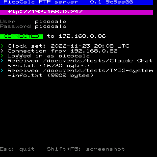

# calcftp

An FTP server for the [PicoCalc](https://www.clockworkpi.com/picocalc) with
a Pico 2 W: the SD card, over Wi-Fi, to any FTP client (FileZilla, WinSCP,
Windows' and Linux's `ftp`, curl, a browser's file manager).



## Using it

1. Wi-Fi is set up in **`/ntp/ntp.cfg`**, the file the PicoCalc shell's
   `NTP` command uses (one place for every program):

   ```
   ssid = MyNetwork
   password = secret
   country = US
   ```

2. Copy `ftp.uf2` (from the [releases](../../releases)) to the card's
   `pico2-apps` folder and run it from the menu.
3. The screen shows where to connect (`ftp://192.168.1.23`), the user name
   and the password. Connect your FTP client to that address, port 21.

The login is in **`/ftp/ftp.cfg`**, made on the first run with the earlier
PicoCalc FTP server's login (the `ftp_user` and `ftp_password` from an old
`/config_ftp.conf`, or else `picocalc` and `picocalc`). Change it there:

```
user = picocalc
password = something
```

On start it **sets the clock** from the NTP server in `/ntp/ntp.cfg`, so
files sent to the PicoCalc are dated; the clock stays set for the shell and
other programs afterwards.

| Key | |
|---|---|
| **Esc** | quit, leaving Wi-Fi properly so the next program joins at once |
| **Shift+F5** | a screenshot, to `/screenshots` |

The screen shows a coloured status (waiting, connected, busy, problem) and a
log of who connected and each file sent or received, with its full path.

## What it does

- Passive (PASV, EPSV) and active (PORT) data connections.
- Listing (LIST, NLST, and MLSD/MLST, which FileZilla uses), get, put,
  append, delete, rename, make and remove folders, SIZE and MDTM.
- One client at a time: a second is told to come back later. In
  FileZilla, set **Site Manager > Transfer Settings > Limit number of
  simultaneous connections** to 1 if it complains.
- Plain FTP, as on a home network; not FTP over TLS.

## Building

It's a Pico SDK program; the pieces it's built from are git submodules,
each pinned to a release:

- Blair Leduc's [picocalc-text-starter](https://github.com/BlairLeduc/picocalc-text-starter)
  (screen, keyboard, SD card) and [picocalc-shell](https://github.com/BlairLeduc/picocalc-shell)
  (the `ntp.cfg` parser, the clock, returning to the shell);
- [picocalc-extras](https://github.com/ctorkildson-netizen/picocalc-extras):
  `net/` (Wi-Fi, TCP with listening, the time), `fatfs/` and `screenshot/`.

```
git clone --recursive https://github.com/ctorkildson-netizen/calcftp
cmake -S calcftp -B calcftp/build -DPICO_SDK_PATH=/path/to/pico-sdk
cmake --build calcftp/build          # -> build/ftp.uf2
```

The server itself is [`src/ftpd.c`](src/ftpd.c), on picocalc-extras'
`net/` calls and FatFs; [`src/main.c`](src/main.c) is the screen.

## Testing on a PC

[`host/`](host/) builds the same `ftpd.c` for Linux, over real sockets and a
FAT disk image, and runs it against Python's FTP client: logins, listings,
a 300 KB file up and back, paths with spaces, active mode, files with no
date, a second client turned away.

```
cd host && make check PICO_SDK_PATH=/path/to/pico-sdk   # needs mkfs.fat, mtools, python3
```

## Licence

MIT: see [LICENSE](LICENSE).
